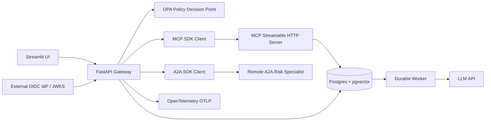

# Enterprise integration architecture

## Trust boundaries

- API validates RS256 OIDC JWT against configured issuer, audience, expiry and JWKS.
- API obtains tenant, subject and scopes from the signed token; not from Streamlit controls.
- OPA is a separate HTTP policy decision point. Missing/unavailable OPA fails closed.
- MCP server independently verifies the caller token before reading tenant-filtered documents.
- A2A specialist is isolated on the private Docker network and returns only synthetic aggregates. It is **not** an authenticated A2A server; add mTLS/workload identity before external exposure.
- Worker derives tenant from the persisted job row. The queue is at-least-once; model calls may repeat after lease expiry.
- pgvector embeddings are intentionally three-dimensional synthetic examples, not real embedding inference.
- Trace export is configured on the API; distributed trace propagation to all services is not yet implemented.

## Operational limitations

This PoC requires a real external OIDC identity provider, issued tokens with a `tenant` claim and scopes, an OpenAI-compatible API key for worker inference, and reachable endpoints. The example does not provision an IdP or issue tokens. No production readiness claim is made.

## Next hardening work

1. Replace demo three-dimensional embeddings with a model-specific embedding service and matching pgvector schema.
2. Add service-to-service mTLS and workload identity for MCP and A2A.
3. Add transactional outbox/receipts for external side effects and a dead-letter queue.
4. Add DB migration framework, backups, secret management and resource limits.
5. Add full OTEL trace context propagation, metrics, alerting, and an eval set using real LLM outputs.
6. Add automated integration tests against a disposable Postgres/OPA/MCP/A2A stack.
